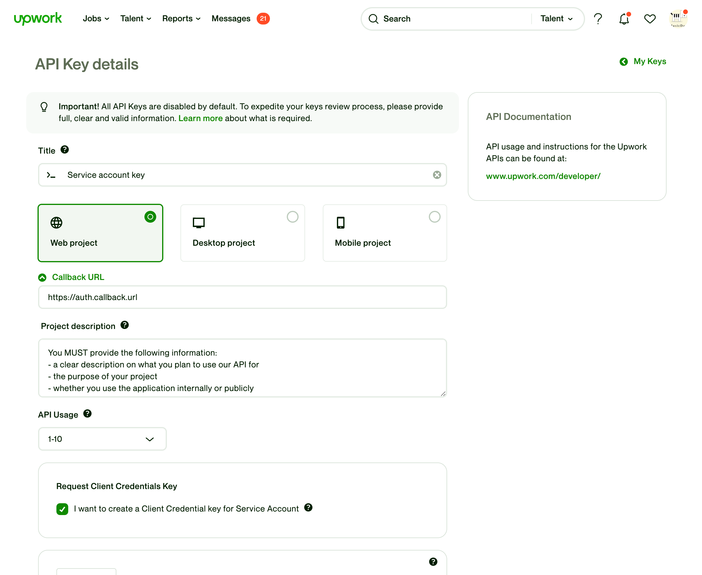

# Authentication

## Authentication (OAuth2)

To access Upwork API, you need to go through an authentication process. Currently, we support the OAuth 2.0 method.

> You need to authenticate for all requests following the OAuth 2.0, RFC 6749.

## OAuth2 Basics

The OAuth 2.0 protocol enables websites or applications (clients) to access protected resources from a Web service (server) via an API, without requiring resource owners to disclose their service provider credentials to the clients. For more information on the OAuth 2.0 workflow process, visit the OAuth 2.0 protocol [official site](https://oauth.net/2/).

### Client ID

For each application you develop, you need to obtain new client credentials. These include a client identifier and a client shared-secret. You can request these credentials in the [API Center](https://www.upwork.com/developer/keys/apply) while logged into your Upwork account (select Key Type OAuth 2.0). You will receive a key (client_id) for each client identifier and client shared-secret you request.

### Required X-Upwork-API-TenantId header

Each request requires the organization context. In order to specify on behalf of which context the request should be executed, you need to send X-Upwork-API-TenantId header. When the header is missing, the request will use the default organization of the user.

### How X-Upwork-API-TenantId header can be used to set the Organization for the execution context

In order to get a value for the X-Upwork-API-TenantId header, you need company selector query. 
‍
 Sample company selector query:

```graphql
query {
  companySelector {
    items {
      title
      organizationId
    }
  }
}
```

The request with X-Upwork-API-TenantId would look like:

```bash
curl --request POST \
  --url https://api.upwork.com/graphql \
  --header 'Authorization: bearer oauth2v2_f5*************************' \
  --header 'Content-Type: application/json' \
  --header 'X-Upwork-API-TenantId: 470*************' \
  --data '{"query":"query { \
      organization { \
      id \
      childOrganizations { \
      id \
      name \
    } \
  } \
}"}'
```

In this case query.organization and organization.childOrganizations will contain information about organization with id 470***********97. 
‍
 Without the header query.organization will contain the information about 584***********76 which is the default organization for the user.

### How the default Organization is selected when the header is not present

A default organization is one of the organizations that the user has access to. It is the same Organization that gets selected as the current Organization when a user logs in into the platform.

## Flow and Supported Grants

For authenticating via OAuth 2.0 protocol, API requests MUST follow RFC 6749 specification.
 At a basic level, the OAuth 2.0 authentication process involves the following steps:

1. Authorize the application using one of the available grants and obtain an Authorization code in Code Authorization Grant
2. Get an Access token in Code Authorization Grant and read it from the Implicit Grant workflow callback that follows the redirect in step#1

Once you receive an access token, you can use it to access protected resources. Use either the access_token parameter, or the Authorization header (recommended) with the Bearer schema and one of the supported grants. TTL for an access token is 24 hours; TTL for a refresh token is 2 weeks since its last usage.

## Supported Grants

- [Authorization Code Grant](authentication.md#authentication)

  - requires authorization request and access token request calls.
- [Authorization Code Grant with PKCE](authentication.md#authentication)

  - recommended for public and mobile clients; requires authorization and token requests with PKCE parameters.
- [Implicit Grant](authentication.md#authentication)

  - requires an authorization request call.
- [Client Credentials Grant](authentication.md#authentication)

  - requires an access token request call. This grant is available for enterprise accounts only.
- [Refresh Token Grant Type](authentication.md#authentication)

  - requires an access token request call.

## Authorization Code Grant

Authorization Code Grant is an OAuth 2.0 flow that enables you to obtain an access token. This grant is used to exchange an authorization code for an access token.

After you return to the client through the redirect URL, the application gets the authorization code from the URL and leverages it to request an access token.

To obtain an access token through the Authorization Code Grant, you must fulfill the following prerequisites and complete the steps thereafter:

1. [Prerequisites](authentication.md#authentication)
2. [Obtain an authorization code](authentication.md#authentication)
3. [Obtain an access token](authentication.md#authentication)

### Prerequisites

| Data | Description |
|---|---|
| Client ID | For each application you develop, you must obtain a client identifier key. To get this value, access [https://www.upwork.com/developer/keys/apply](https://www.upwork.com/developer/keys/apply) and log in by using your Upwork credentials   **Notes:**  You must be an enterprise client user or freelancer to request these details. For more information, see [requesting an API key](https://support.upwork.com/hc/en-us/articles/115015857647-Request-an-API-Key). |
| Client Secret | For each application you develop, you must obtain a client shared-secret key. To get this value, access [https://www.upwork.com/developer/keys/apply](https://www.upwork.com/developer/keys/apply) and log in by using your Upwork credentials   **Notes:**  You must be an enterprise client user or freelancer to request these details. For more information, see [requesting an API key](https://support.upwork.com/hc/en-us/articles/115015857647-Request-an-API-Key). |
| Callback URL | The URI to which Upwork redirects the browser after authentication. This is also known as redirect URI.  **Notes:**  This is applicable to a web project. For more information, see [requesting an API key](https://support.upwork.com/hc/en-us/articles/115015857647-Request-an-API-Key). |

### Step 1. Obtaining an authorization code

The Upwork server must request authorization from the resource owner to grant you access to the required data. To do so, you must redirect the resource owner to Upwork server’s authentication endpoint.

> Keep the refresh and access token private. If someone obtains your tokens, they could use them to access private user data.

### Endpoint

GET

https://www.upwork.com/ab/account-security/oauth2/authorize

‍

### Parameters

response_type

required

,

string

‍

The corresponding grant type. Use

code

for Authorization Code Grant.

client_id

required

,

string

‍

Your Client ID.

redirect_uri

required

,

string

‍

Redirect URI, must be equal or similar to the callback specified in the key settings.

‍

### Returns

Returns the code.

```
<!DOCTYPE html>
            <html lang="en">
              <head>
                <meta charset="UTF-8" />
                <meta http-equiv="refresh" content="0;url='https://upwork.com/ab/messages/rooms/?code=b094053c2892cb819942e2d01e7237e7'" />
                <title>Redirecting to https://upwork.com/ab/messages/rooms/?code=b094053c2892cb819942e2d01e7237e7</title>
              </head>
              <body>
                Redirecting to <a href="https://upwork.com/ab/messages/rooms/?code=b094053c2892cb819942e2d01e7237e7">https://upwork.com/ab/messages/rooms/?code=b094053c2892cb819942e2d01e7237e7</a>.
              </body>
            </html>
```

Here, [https://upwork.com/ab/messages/rooms/](https://upwork.com/ab/messages/rooms/) is the Callback URL and b094053c2892cb819942e2d01e7237e7 is the authorization code.

### Step 2. Obtaining an access token

> Keep the access token private. If someone obtains your token, they could use it to access private user data.

### Endpoint

POST

https://www.upwork.com/api/v3/oauth2/token

‍

### Parameters

grant_type

required

,

string

‍

Grant type. To get a token right after authorization, use

authorization_code

.

client_id

required

,

string

‍

Your Client ID.

client_secret

required

,

string

‍

Your Client Secret.

code

required

,

string

‍

Authorization code received during the authorization request.

redirect_uri

required

,

string

‍

Redirect URI, must be equal or similar to the callback specified in the key settings.

‍

### Returns

Returns the access token and its TTL. Example:

```
// Sample request
curl --request POST \
  --url https://www.upwork.com/api/v3/oauth2/token \
  --header 'Content-Type: application/x-www-form-urlencoded' \
  --header 'Accept: application/json' \
  --data 'client_id=API_KEY_HERE&client_secret=KEY_SECRET_HERE&code=AUTHORIZATION_CODE_FROM_FIRST_STEP&grant_type=authorization_code&redirect_uri=CALLBACK_URL'

// Authorization Code Grant - sample response
{"access_token":"oauth2v2_cec*************************60","refresh_token":"oauth2v2_40d*************************40","token_type":"Bearer","expires_in":86400}
```

## Authorization Code Grant with PKCE

The Authorization Code Grant with PKCE is recommended as a replacement for Implicit Grant (`response_type=token`), which is going to be deprecated in future (see [OAuth 2.0 Security BCP (RFC 9700)](https://datatracker.ietf.org/doc/html/rfc9700)) and removed entirely from OAuth 2.1 ([RFC 9700 §2.4.1](https://datatracker.ietf.org/doc/html/rfc9700#section-2.4.1) and [RFC 7636](https://datatracker.ietf.org/doc/html/rfc7636) for PKCE).

Authorization Code Grant with PKCE follows the same overall flow as the Authorization Code Grant, but adds a `code_verifier` and `code_challenge` pair per [RFC 7636](https://datatracker.ietf.org/doc/html/rfc7636). The client generates a random `code_verifier`, derives a `code_challenge`, sends the challenge in the authorization request, and sends the original verifier when exchanging the authorization code for an access token.

PKCE is especially suited for public clients such as mobile, single-page, and native applications where a client secret cannot be stored securely.

To obtain an access token through the Authorization Code Grant with PKCE, you must fulfill the following prerequisites and complete the steps thereafter:

1. [Prerequisites](authentication.md#authentication)
2. [Obtain an authorization code](authentication.md#authentication)
3. [Obtain an access token](authentication.md#authentication)

### Prerequisites

| Data | Description |
|---|---|
| Client ID | For each application you develop, you must obtain a client identifier key. To get this value, access [https://www.upwork.com/developer/keys/apply](https://www.upwork.com/developer/keys/apply) and log in by using your Upwork credentials   **Notes:**  You must be an enterprise client user or freelancer to request these details. For more information, see [requesting an API key](https://support.upwork.com/hc/en-us/articles/115015857647-Request-an-API-Key). |
| Client Secret | For each application you develop, you must obtain a client shared-secret key. To get this value, access [https://www.upwork.com/developer/keys/apply](https://www.upwork.com/developer/keys/apply) and log in by using your Upwork credentials   **Notes:**  You must be an enterprise client user or freelancer to request these details. For more information, see [requesting an API key](https://support.upwork.com/hc/en-us/articles/115015857647-Request-an-API-Key). |
| Callback URL | The URI to which Upwork redirects the browser after authentication. This is also known as redirect URI.  **Notes:**  This is applicable to a web project. For more information, see [requesting an API key](https://support.upwork.com/hc/en-us/articles/115015857647-Request-an-API-Key). |
| PKCE code verifier and challenge | Before starting the authorization request, generate a `code_verifier` and derive a `code_challenge` from it using the **S256** method as defined in [RFC 7636](https://datatracker.ietf.org/doc/html/rfc7636).   **Notes:**  PKCE is recommended for public clients (mobile, SPA, and native apps) where the client secret cannot be stored securely. Store the `code_verifier` securely on the client until the token exchange step. |

### Step 1. Obtaining an authorization code

The Upwork server must request authorization from the resource owner to grant you access to the required data. To do so, you must redirect the resource owner to Upwork server’s authentication endpoint and include the PKCE challenge parameters.

### Endpoint

GET

https://www.upwork.com/ab/account-security/oauth2/authorize

‍

### Parameters

response_type

required

,

string

‍

The corresponding grant type. Use

code

for Authorization Code Grant with PKCE.

client_id

required

,

string

‍

Your Client ID.

redirect_uri

required

,

string

‍

Redirect URI, must be equal or similar to the callback specified in the key settings.

code_challenge

required

,

string

‍

PKCE challenge derived from the

code_verifier

.

code_challenge_method

required

,

string

‍

Method used to derive the challenge. Use

S256

.

‍

### Returns

Returns the code and state as parameters in the callback/redirect_uri, i.e. executes a redirect to the specified URL.

For example, https://upwork.com/ab/messages/rooms/?code=b094053c2892cb819942e2d01e7237e7&state=a92cbi819942e2d01. Here, [https://upwork.com/ab/messages/rooms/](https://upwork.com/ab/messages/rooms/) is the Callback URL, b094053c2892cb819942e2d01e7237e7 and a92cbi819942e2d01 are the authorization code and state respectively.

### Step 2. Obtaining an access token

The logic behind the redirected URL must handle the code/state callback, verify the state and send the request for obtaining an access/refresh token.

> Keep the access token private. If someone obtains your token, they could use it to access private user data.

### Endpoint

POST

https://www.upwork.com/api/v3/oauth2/token

‍

### Parameters

grant_type

required

,

string

‍

Grant type. To get a token right after authorization, use

authorization_code

.

client_id

required

,

string

‍

Your Client ID.

client_secret

required

,

string

‍

Your Client Secret.

code

required

,

string

‍

Authorization code received during the authorization request. Short-lived code, useless alone.

redirect_uri

required

,

string

‍

Redirect URI, must be equal or similar to the callback specified in the key settings.

code_verifier

required

,

string

‍

Original PKCE verifier used to create the

code_challenge

sent in step 1. Proves possession of original secret.

‍

### Returns

Returns the access token and its TTL, and a refresh token. Example:

```
// Sample request
curl --request POST \
  --url https://www.upwork.com/api/v3/oauth2/token \
  --header 'Content-Type: application/x-www-form-urlencoded' \
  --header 'Accept: application/json' \
  --data 'client_id=API_KEY_HERE&code=AUTHORIZATION_CODE_FROM_FIRST_STEP&grant_type=authorization_code&redirect_uri=CALLBACK_URL&code_verifier=CODE_VERIFIER_FROM_PKCE_STEP'

// Authorization Code Grant with PKCE - sample response
{"access_token":"oauth2v2_cec*************************60","refresh_token":"oauth2v2_40d*************************40","token_type":"Bearer","expires_in":86400}
```

## Implicit Grant

Implicit Grant is an OAuth 2.0 flow that enables you to obtain an access token without obtaining an authorization code.

When the system redirects you to the client through the redirect URL, the application appends the access token in the URI. Therefore, unlike the Authorization Code Grant, you do not need to leverage the temporary code to obtain an access token.

To obtain an access token through the Implicit Grant, you must fulfill the following prerequisites and complete the steps thereafter:

1. [Prerequisites](authentication.md#authentication)
2. [Obtain an access token](authentication.md#authentication)

### Prerequisites

| Data | Description |
|---|---|
| Client ID | For each application you develop, you must obtain a client identifier key. To get this value, access [https://www.upwork.com/developer/keys/apply](https://www.upwork.com/developer/keys/apply) and log in by using your Upwork credentials.   **Notes:**  You must be an enterprise client user or freelancer to request these details. For more information, see [requesting an API key](https://support.upwork.com/hc/en-us/articles/115015857647-Request-an-API-Key). |
| Callback URL | The URI to which Upwork redirects the browser after authentication. This is also known as redirect URI.  **Notes:**  This is applicable for a web project. For more information, see [requesting an API key](https://support.upwork.com/hc/en-us/articles/115015857647-Request-an-API-Key). |

### Step 1. Obtaining an access token

The Upwork server must request authorization from the resource owner to grant you access to the required data. To do so, you must redirect the resource owner to Upwork server’s authentication endpoint.

> Keep the access token private. If someone obtains your token, they could use it to access private user data.

### Endpoint

GET

https://www.upwork.com/ab/account-security/oauth2/authorize

‍

### Parameters

response_type

required

,

string

‍

The corresponding grant type. Use

token

for Implicit Grant.

client_id

required

,

string

‍

Your Client ID.

redirect_uri

required

,

string

‍

Redirect URI, must be equal or similar to the callback specified in the key settings.

‍

### Returns

Returns the access token and its TTL. Example:

```
/#access_token=abcdefghijklmnopqrstuvwxyz&expires_in=86399 // Implicit Grant
```

## Client Credentials Grant

Client Credentials Grant is an OAuth 2.0 flow that enables you to obtain an access token in server-to-server and client-to-server scenarios. Although users are involved in this flow, you can use the access token outside the context of a user. For example, you can leverage the access token to access the client's resources.

To obtain an access token through the Client Credentials Grant, you must fulfill the following prerequisites and complete the steps thereafter:

1. [Prerequisites](authentication.md#authentication)
2. [Obtain an access token](authentication.md#authentication)

> Client Credentials grant is only available to Enterprise consumers

### Prerequisites

| Data | Description |
|---|---|
| Client ID | For each application you develop, you must obtain a client identifier key. To get this value, access [https://www.upwork.com/developer/keys/apply](https://www.upwork.com/developer/keys/apply) and log in by using your Upwork credentials.   **Notes:**  You must be an enterprise client user or freelancer to request these details. For more information, see [requesting an API key](https://support.upwork.com/hc/en-us/articles/115015857647-Request-an-API-Key). |
| Client Secret | For each application you develop, you must obtain a client shared-secret key. To get this value, access [https://www.upwork.com/developer/keys/apply](https://www.upwork.com/developer/keys/apply) and log in by using your Upwork credentials.   **Notes:**  You must be an enterprise client user or freelancer to request these details. For more information, see [requesting an API key](https://support.upwork.com/hc/en-us/articles/115015857647-Request-an-API-Key). |

### Step 1. Obtaining an access token

> Keep the access token private. If someone obtains your token, they could use it to access private user data.

### Endpoint

POST

https://www.upwork.com/api/v3/oauth2/token

‍

### Parameters

grant_type

required

,

string

‍

Grant type. To get an access token for the client credentials grant, use

client_credentials

.

client_id

required

,

string

‍

Your Client ID.

client_secret

required

,

string

‍

Your Client Secret.

‍

### Returns

Returns the access token and its TTL. Example:

```json
{
  "access_token": "oauth2v2_584006c0ef4f69fd8278c7769da6ff43",
  "token_type": "Bearer",
  "expires_in": 86400
}
```

## Refresh Token Grant Type

Refresh Token Grant Type is an OAuth 2.0 flow that enables you to exchange a refresh token for an access token when the access token has expired. Therefore, you can continue to have a valid access token without further interaction with the user.

To obtain an access token through the Refresh Token Grant Type, you must fulfill the following prerequisites and complete the steps thereafter:

1. [Prerequisites](authentication.md#authentication)
2. [Obtain an access token](authentication.md#authentication)

### Prerequisites

| Data | Description |
|---|---|
| Client ID | For each application you develop, you must obtain a client identifier key. To get this value, access [https://www.upwork.com/developer/keys/apply](https://www.upwork.com/developer/keys/apply) and log in by using your Upwork credentials.   **Notes:**  You must be an enterprise client user or freelancer to request these details. For more information, see [requesting an API key](https://support.upwork.com/hc/en-us/articles/115015857647-Request-an-API-Key). |
| Client Secret | For each application you develop, you must obtain a client shared-secret key. To get this value, access [https://www.upwork.com/developer/keys/apply](https://www.upwork.com/developer/keys/apply) and log in by using your Upwork credentials.   **Notes:**  You must be an enterprise client user or freelancer to request these details. For more information, see [requesting an API key](https://support.upwork.com/hc/en-us/articles/115015857647-Request-an-API-Key). |

### Step 1. Obtaining an access token

> Keep the refresh token private. If someone obtains your token, they could use it to access private user data.

### Endpoint

POST

https://www.upwork.com/api/v3/oauth2/token

‍

### Parameters

grant_type

required

,

string

‍

Grant type. To refresh an existing token, having a valid refresh token, use

refresh_token

.

client_id

required

,

string

‍

Your Client ID.

client_secret

required

,

string

‍

Your Client Secret.

refresh_token

required

,

string

‍

A valid refresh token.

‍

### Returns

If you authenticated previously and have a working refresh token, this call returns the refreshed tokens and the TTL of the access token.

```json
{
  "access_token": "oauth2v2_daedc8c79a4d5f80b88b2ce953772a0f",
  "refresh_token": "oauth2v2_e8ae4feb6b8d10693d8cff420351461a",
  "token_type": "Bearer",
  "expires_in": 86400
}
```

## Service accounts

Service accounts are specific to a service or application and are designed to run applications. Service accounts help you communicate with multiple applications, such as web servers and databases. Unlike user accounts, service accounts are used by system services, for example, web servers, mail transport agents, and databases.

Service accounts are useful when you need to fetch information. For example, you can use service accounts to get information about multiple users in a company. However, you must not use service accounts to perform write operations.

> Note that service accounts are available only for enterprise accounts in Upwork.

### Prerequisites for using a Service Account in Upwork

- You must

  [apply for the client credentials key](authentication.md#authentication)

  .

After Upwork creates the Client Credentials key and associates it with a service account, you can assign appropriate [scopes](application-permissions.md) and [permissions](authentication.md#authentication) to the service account.

## Requesting a Client Credentials key

To apply for the Client Credentials key:

1. Go to

  [https://www.upwork.com/developer/keys/apply](https://www.upwork.com/developer/keys/apply)

  and provide the requested information about your application.

  For more information, see the

  [Getting Started](README.md)

  section.
2. Select the

  **I want to create a Client Credential key for Service Account**

  check box.

  
3. Select the relevant scopes. For more information, see

  [scopes](application-permissions.md)

  .
4. Save the changes.

Upwork creates the Client Credentials key and displays the values in a pop-up window. In addition, you can view your key at [https://www.upwork.com/developer/keys/](https://www.upwork.com/developer/keys/).

Upwork also creates a Service Account and associates the account with the Client Credentials key. Thereafter, if you perform any actions by using the key, the system actually performs such actions on behalf of the Service Account and not your user account.

## Assigning Scopes to Service Accounts

Scopes are collections of permissions to access a specific set of APIs. They are usually grouped by domain and provide more control over sharing your account resources with different roles within your organization.

While applying for the Client Credentials key, you can select the relevant Scopes. These Scopes define the APIs that you can access by using the same key. For more information about Scopes, see [What are Scopes](application-permissions.md).

## Assigning permissions to Service Accounts

A Service Account is a user entity. By default, Service Accounts do not have any permissions. To access data by using a Service Account, you must have proper permissions associated with the Service Account.

To assign permissions to Service Accounts:

1. Log in to your Service Account.
2. Under Settings > Members & Permissions, locate the Service Account and update permissions according to the available options. You can set both team and company-level permissions depending on your needs. For more information, see

  [Team Permissions](https://support.upwork.com/hc/en-us/articles/115000394427-Team-Permissions)

  .

Now, you are ready to leverage your service account to call Upwork’s APIs and perform specific operations.

## Authorization Request

The Upwork server must request authorization from the resource owner to grant you access to the required data. To do so, you must redirect the resource owner to Upwork server’s authentication endpoint.

> Keep the refresh and access token private. If someone obtains your tokens, they could use them to access private user data.

### Endpoint

GET

https://www.upwork.com/ab/account-security/oauth2/authorize

‍

### Parameters

response_type

required

,

string

‍

The corresponding Grant Type. Use `code` for Authorization Code Grant and `token` for Implicit Grant.

Valid values: code, token

client_id

required

,

string

‍

Your Client ID.

redirect_url

required

,

string

‍

The callback URL.

‍

### Returns

Returns a code for the Authorization Code Grant or an access token for the Implicit Grant. Example:

/#access_token=abcdefghijklmnopqrstuvwxyz&expires_in=86399 // Implicit Grant

## Access Token Request

> Keep the refresh and access token private. If someone obtains your tokens, they could use them to access private user data.

### Endpoint

POST

https://www.upwork.com/api/v3/oauth2/token

‍

### Parameters

grant_type

required

,

string

‍

Grant type. To get a token right after authorization, use `authorization_code`. To refresh an existing token, having a valid `refresh token`, use `refresh_token`.

To get an access token for the client credentials grant, use `client_credentials`.

Valid values: authorization_code, refresh_token, client_credentials

client_id

required

,

string

‍

Your Client ID.

client_secret

required

,

string

‍

Your Client Secret.

code

conditionally required

,

string

‍

Authorization code received during the authorization request. Required for `authorization_code` grant.

redirect_uri

conditionally required

,

string

‍

Redirect URI, must be equal or similar to the callback specified in the key settings. Required for `authorization_code` grant.

refresh_token

conditionally required

,

string

‍

A valid refresh token. Required for `refresh_token` grant.

‍

### Returns

If the authorization is successful, this call returns the tokens and the TTL of the access token.

## Refresh Token Request

The Access Token request should be used with the proper grant type, which is "refresh_token", in order to refresh the token.

> Keep the refresh and access token private. If someone obtains your tokens, they could use them to access private user data.

### Returns

If you authenticated previously and have a working refresh token, this call returns the refreshed tokens and the TTL of the access token.

‍
