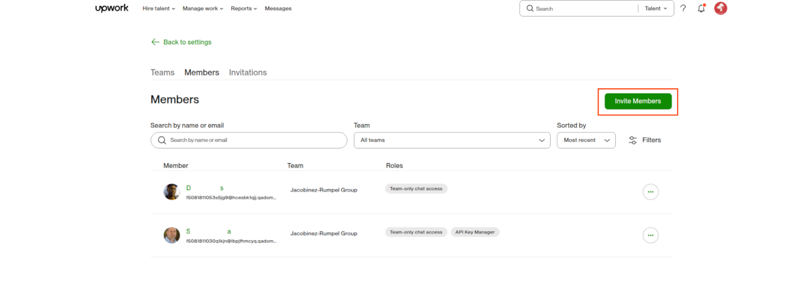
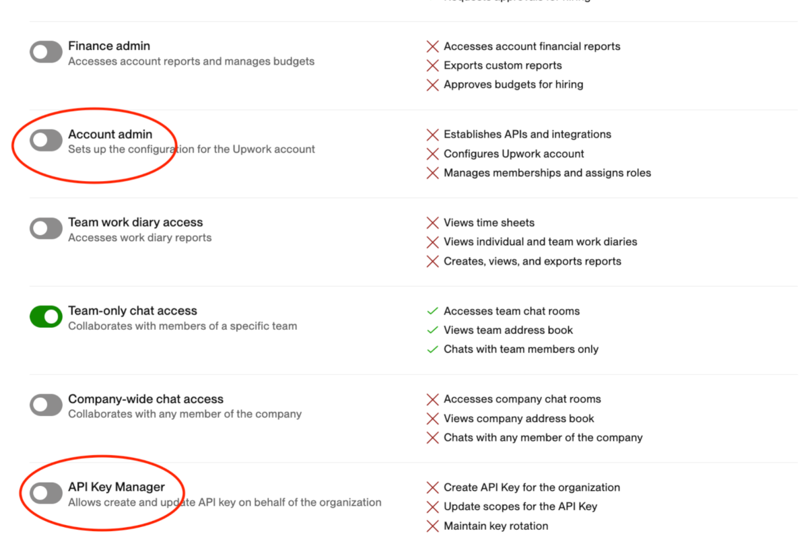
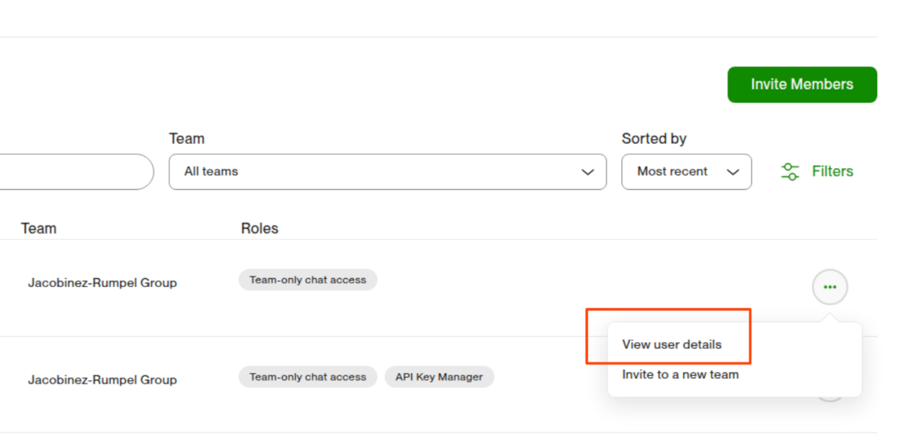
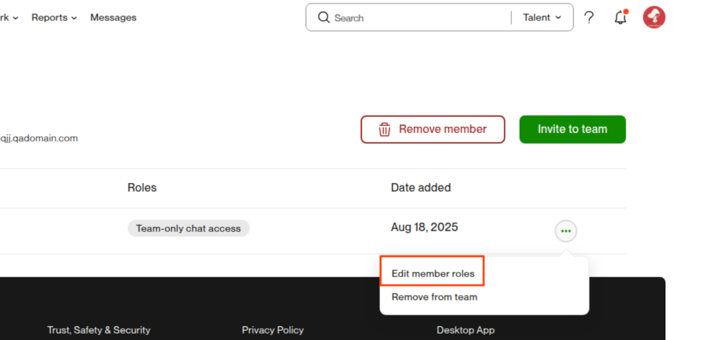
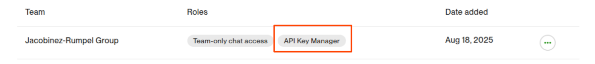

# Keys Management

When an API key is created, it is associated with the current context selected in the top-right menu (e.g., personal or organizational context). Please note, API keys cannot be transferred between contexts after creation.

For organizational use, ensure that the correct organization is selected before generating the key. If a key is created under a personal context, it will remain associated with that individual account.

To simplify key management, organization administrators can delegate key creation and management to specific members by assigning the appropriate permissions. API keys created by authorized members within an organizational context are owned by the organization—not by the individual who generated them. Ownership remains with the organization even if the member later leaves.

## Granting API Key Management Permissions

To grant a member of your organization permission to create and manage API keys, follow these steps:

**Step 1: Navigate to the following URL**: [https://www.upwork.com/nx/org-management/members](https://www.upwork.com/nx/org-management/members). Make sure you are logged in with the appropriate account and have selected the correct organizational context.

Step 2: Add or Select Team Members

: To invite a new member to your organization, click "Invite Members". Once the member has been added, or if the member already exists, select their name from the team list and assign the "API Key Manager" permission.

To be able to manage keys for an organization, you must have one of the following permissions: "Account Admin" or "API Key Manager".

 

  

Step 3: Member Can Now Manage API Keys

: The selected team member now has permission to create and manage API keys on behalf of the organization. All keys created under the organizational context will be owned by the organization.

