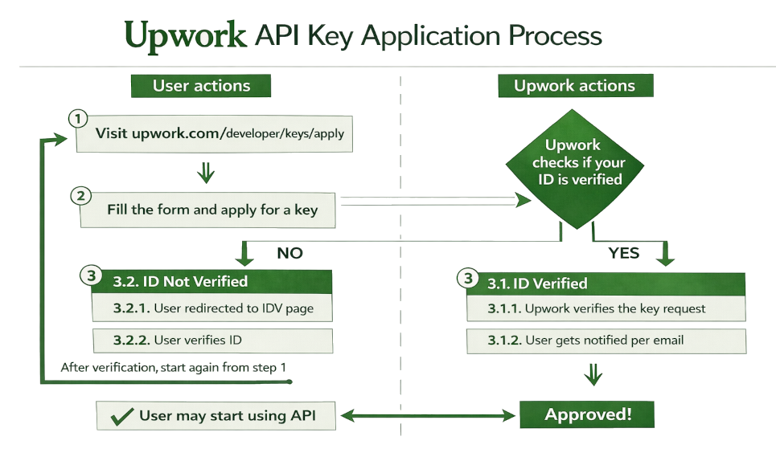

# Preparation

Before you start using Upwork API, you need to register your application and obtain your client credentials (a.k.a consumer key and consumer secret). To register, you just fill in basic information about your application and its intended use.

> Before you apply for a key, select the organization (context) from the menu. The key will be created under the selected context, who will be the owner of the key.

https://www.upwork.com/developer/keys/apply

Every new request for an API Key will be reviewed. For a quick positive decision, you need to comply the following conditions:

1. To be considered for API access, your Upwork account must have:
  - A valid, authentic name
  - A valid address in your personal or company profile
  - A valid profile picture
  - An active, verified payment method
  - Completed identity verification
  - At least $25,000 in lifetime earnings, spend, or a combination of both
  - A Job Success Score of at least 90% (for freelancers and agencies)
  - An account in good standing with no active suspensions
2. You also must include:
  - A clear description of how you plan to use the API
    - Whether the API will be used for an internal or public application
    - Your role (client, agency owner, or developer) and why you need an API key
    - If you're requesting access on behalf of a client, the client's Upwork account email address
  - A new request that isn't a duplicate of an already approved API key
  - Confirmation that your application will stay within the daily request limit of 40,000 API requests
  - Confirmation that your application won't use the Upwork name, logo, brand colors, or other trademarked assets

Find more details on this [Support Page](https://support.upwork.com/hc/en-us/articles/115015857647-How-to-request-an-API-key-from-Upwork).

> Users who try registering a new application/key, but have a profile without a valid ID will be forced to go through the ID verification process.

